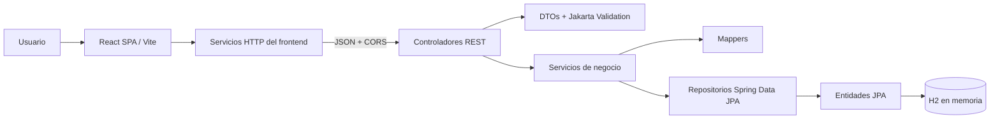
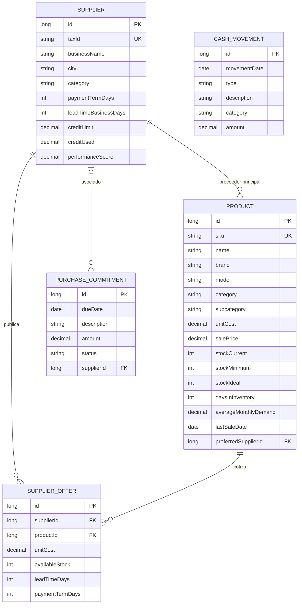

# Especificación técnica — Inventario y flujo de caja

| Campo | Valor |
|---|---|
| Estado | Aprobada por el responsable del proyecto; sujeta a validación del docente/equipo si aplica |
| Versión | 0.1 |
| PRD relacionado | [`PRD.md`](PRD.md) |
| Referencias de interfaz | [`stitch_inventario_y_flujo_de_caja/`](stitch_inventario_y_flujo_de_caja/) |

## 1. Alcance técnico

Describe el prototipo local: frontend React, backend REST Spring Boot, H2 en memoria, movimientos/compromisos ficticios y reglas de inventario. No define arquitectura de producción ni representa la caja real. No hay ventas históricas completas ni órdenes aprobadas.

## 2. Stack y versiones observadas

| Componente | Versión/configuración observada |
|---|---|
| Java | JDK 17; entorno local observado: 17.0.18 |
| Spring Boot | 4.0.9 |
| Maven | Maven Wrapper; entorno observado: 3.10.0 |
| Spring Data JPA / Hibernate | Versiones gestionadas por Spring Boot; runtime observado Hibernate 7.2.25.Final |
| H2 | Runtime observado 2.4.240, modo memoria |
| React / React DOM | 19.3.1 |
| Vite | 8.x; `package.json` declara `^8.3.6`, instalación observada 8.3.8 |
| Node.js / npm | Entorno observado Node 24.12.0 y npm 11.6.2 |
| Estilos | CSS local, tokens de `stitch_inventario_y_flujo_de_caja/enterprise_it_asset_cash_flow_suite/DESIGN.md`; Inter y Roboto Mono con fallback |

Las versiones deben actualizarse si cambian `pom.xml`, `package-lock.json` o el JDK del equipo. Vite 8 requiere Node compatible actual; registrar la versión que realmente use cada integrante.

## 3. Arquitectura y responsabilidades



- **Frontend:** `frontend/src/app` administra navegación SPA; `features/` contiene pantallas; `services/` centraliza consumo HTTP; `components/` agrupa elementos comunes y layout. Los HTML de Stitch se conservan como referencia, no se insertan directamente en React.
- **Controladores:** traducen HTTP/DTO a casos de uso y devuelven códigos REST; no contienen cálculos de negocio.
- **DTOs:** desacoplan JSON de entidades y validan solicitudes.
- **Servicios:** aplican reglas de stock, unicidad, comparación, movimientos de caja, compromisos y métricas.
- **Repositorios:** acceso a `Product`, `Supplier` y `SupplierOffer` con Spring Data JPA.
- **Mappers:** convierten entidades a respuestas y agregan campos calculados para la vista.
- **Excepciones:** `GlobalExceptionHandler` devuelve Problem Details, errores de validación, 404, 409 y errores internos sin traza al cliente.
- **Persistencia:** Hibernate crea y elimina el esquema de H2 en cada ejecución; `DemoDataInitializer` carga fixtures.

### Paquetes principales

```text
backend/src/main/java/com/tdea/backend/
├── api/controller/      # Endpoints REST
├── api/dto/             # Contratos JSON
├── api/mapper/          # Entidad a DTO
├── common/exception/    # Problem Details y errores de dominio
├── config/              # CORS y datos de demostración
├── domain/entity/       # Product, Supplier, SupplierOffer, CashMovement, PurchaseCommitment
├── domain/enums/        # Categorías, estados de producto, tipos de movimiento y compromiso
├── repository/          # Spring Data JPA
└── service/             # Reglas de negocio y casos de uso
```

```text
frontend/src/
├── app/                 # Shell/navegación
├── components/common/   # Iconos, estados, formularios visuales
├── components/layout/   # Sidebar, topbar y toast
├── features/            # Dashboard, productos, alertas, proveedores, compras
├── services/            # Cliente HTTP y servicios por recurso
└── utils/               # Formato COP y etiquetas
```

## 4. Modelo de datos



### Restricciones

- `Product.sku` único, obligatorio; mínimo de stock no puede superar stock ideal.
- `Supplier.taxId` único, obligatorio; cupo utilizado no puede superar límite.
- Una oferta por par proveedor/producto (`supplier_id`, `product_id` único).
- Movimientos de caja: monto positivo, tipo `INCOME` o `EXPENSE`, fecha no futura.
- Compromisos: monto positivo y estado `OPEN` o `PAID`; proveedor opcional. Pagar un compromiso crea una única salida de caja y cambia su estado en la misma transacción.
- Costos, precios y cupos se almacenan como `BigDecimal` con precisión decimal, moneda de demostración COP.
- Entidades monetarias y contactos contienen datos ficticios; no existen cuentas bancarias.
- No existe un ledger completo de movimientos de stock/ventas: la rotación se estima con `lastSaleDate` y los fixtures son sintéticos.
- No existe entidad para órdenes de compra aprobadas, conciliación bancaria o movimientos de caja reales.

### Datos iniciales

`DemoDataInitializer` crea 20 productos, 5 proveedores, 40 ofertas, 4 movimientos de caja y 3 compromisos ficticios. El saldo inicial predeterminado es COP 320.000.000 (`app.cash.opening-balance-cop`, variable `CASH_OPENING_BALANCE_COP`). Los productos antiguos tienen fechas de última venta variadas/nulas para probar baja rotación. La H2 en memoria se configura con `ddl-auto=create-drop`; al reiniciar se pierden cambios y se vuelven a cargar los fixtures.

## 5. Reglas de negocio implementadas

1. `ProductStatus.CRITICAL`: existencias actuales `<=` mínimo.
2. `ProductStatus.OVERSTOCK`: existencias actuales `>` ideal; en otro caso `OPTIMAL`.
3. Filtro de edad: `daysInInventory > olderThanDays`; 90 días exactos no pasan el filtro `olderThanDays=90`.
4. Baja rotación: `stockCurrent > 0`, `daysInInventory > 90` y última venta nula o estrictamente anterior a `hoy - 90 días`.
5. Sugerencias solo para producto crítico con existencias menores al ideal.
6. Cantidad sugerida: `max(stockIdeal - stockCurrent, 0)`.
7. Elección de oferta: primero ofertas capaces de cubrir la cantidad total, menor costo unitario y, en empate, menor plazo. Si ninguna tiene suficiente stock, se muestra la más económica con advertencia.
8. Valor de inventario: `unitCost × stockCurrent`.
9. Valor de reabastecimiento: `cantidad sugerida × costo unitario de la oferta seleccionada`.
10. Saldo de caja demo: `COP 320.000.000 + ingresos - gastos` hasta hoy.
11. Capacidad de reorden demo: saldo actual menos compromisos `OPEN` con vencimiento desde hoy hasta hoy + 30 días, inclusive. El valor puede ser negativo.
12. Al marcar un compromiso pagado, se cambia a `PAID` y se crea un movimiento `EXPENSE` con fecha actual; así el saldo disminuye y el compromiso deja de restarse en el horizonte futuro, sin doble conteo.
13. Dashboard y etiquetas deben advertir que saldo, movimientos y compromisos son ficticios. El cupo de crédito del proveedor no equivale al dinero disponible del negocio.

## 6. API REST

Base local: `http://localhost:${SERVER_PORT:-8080}/api`. JSON en camelCase. La API no usa autenticación.

| Verbo | Endpoint | Parámetros/entrada | Respuesta principal |
|---|---|---|---|
| GET | `/dashboard/summary` | — | `200 DashboardSummaryResponse` |
| GET | `/products` | `search`, `category`, `status`, `olderThanDays`, `lowRotation` | `200 ProductResponse[]` |
| GET | `/products/{id}` | ID positivo | `200 ProductResponse`; 404 si no existe |
| POST | `/products` | `ProductRequest` validado | `201 ProductResponse`, encabezado `Location` |
| PUT | `/products/{id}` | ID + `ProductRequest` | `200 ProductResponse` |
| DELETE | `/products/{id}` | ID | `204`; elimina ofertas asociadas |
| GET | `/suppliers` | `search`, `category`, `paymentTermDays` | `200 SupplierResponse[]` |
| GET | `/suppliers/{id}` | ID positivo | `200 SupplierResponse`; 404 si no existe |
| POST | `/suppliers` | `SupplierRequest` validado | `201 SupplierResponse`, encabezado `Location` |
| PUT | `/suppliers/{id}` | ID + `SupplierRequest` | `200 SupplierResponse` |
| DELETE | `/suppliers/{id}` | ID | `204`; 409 si conserva productos, ofertas o compromisos asociados |
| GET | `/purchase-suggestions` | búsqueda opcional `search` | `200 PurchaseSuggestionResponse[]` |
| GET | `/products/{productId}/supplier-offers` | ID de producto | `200 SupplierOfferResponse[]` ordenadas por costo |
| GET | `/cash-flow/summary` | `from`, `to` opcionales (ISO `YYYY-MM-DD`) | `200 CashFlowSummaryResponse` |
| GET | `/cash-flow/movements` | `from`, `to` opcionales | `200 CashMovementResponse[]` |
| GET | `/cash-flow/movements/{id}` | ID positivo | `200 CashMovementResponse`; 404 si no existe |
| POST | `/cash-flow/movements` | `CashMovementRequest` | `201 CashMovementResponse` |
| GET | `/cash-flow/commitments` | `status` opcional (`OPEN`/`PAID`) | `200 PurchaseCommitmentResponse[]` |
| GET | `/cash-flow/commitments/{id}` | ID positivo | `200 PurchaseCommitmentResponse`; 404 si no existe |
| POST | `/cash-flow/commitments` | `PurchaseCommitmentRequest` | `201 PurchaseCommitmentResponse` |
| PATCH | `/cash-flow/commitments/{id}/pay` | ID positivo | `200 PurchaseCommitmentResponse`; 409 si ya fue pagado |

`category` y `status` reciben nombres enum en mayúsculas, por ejemplo `LAPTOPS`, `SERVERS`, `CRITICAL`. `olderThanDays=90` aplica comparación estricta. `lowRotation=true` aplica la regla de baja rotación aprobada.

### Esquemas JSON principales

#### Crear/actualizar producto — `ProductRequest`

```json
{
  "sku": "LAP-DEMO-001",
  "name": "Portátil de demostración",
  "brand": "Marca Demo",
  "model": "Modelo A",
  "category": "LAPTOPS",
  "subcategory": "Portátiles empresariales",
  "unitCost": 5200000,
  "salePrice": 6400000,
  "stockCurrent": 2,
  "stockMinimum": 5,
  "stockIdeal": 10,
  "daysInInventory": 112,
  "averageMonthlyDemand": 4.2,
  "lastSaleDate": "2026-07-01",
  "preferredSupplierId": 1
}
```

`lastSaleDate` es nullable. `ProductResponse` añade `id`, `lowRotation`, `status`, `unitsToReorder`, `inventoryValue`, `preferredSupplierId` y `preferredSupplierName` a los datos del catálogo.

Ejemplo completo de respuesta `ProductResponse`:

```json
{
  "id": 1,
  "sku": "LAP-DEMO-001",
  "name": "Portátil de demostración",
  "brand": "Marca Demo",
  "model": "Modelo A",
  "category": "LAPTOPS",
  "subcategory": "Portátiles empresariales",
  "unitCost": 5200000.00,
  "salePrice": 6400000.00,
  "stockCurrent": 2,
  "stockMinimum": 5,
  "stockIdeal": 10,
  "daysInInventory": 112,
  "averageMonthlyDemand": 4.20,
  "lastSaleDate": "2026-07-01",
  "lowRotation": true,
  "status": "CRITICAL",
  "unitsToReorder": 8,
  "inventoryValue": 10400000.00,
  "preferredSupplierId": 1,
  "preferredSupplierName": "Ingram Micro Colombia S.A.S."
}
```

#### Crear/actualizar proveedor — `SupplierRequest`

```json
{
  "taxId": "900000123-4",
  "businessName": "Proveedor de demostración S.A.S.",
  "city": "Bogotá",
  "address": "Dirección ficticia",
  "billingEmail": "ventas@example.invalid",
  "phone": "+57 601 000 0000",
  "contactName": "Contacto de demostración",
  "category": "COMPUTERS",
  "paymentTermDays": 30,
  "leadTimeBusinessDays": 5,
  "creditLimit": 100000000.00,
  "creditUsed": 25000000.00,
  "performanceScore": 92.50,
  "representedBrands": "Marca Demo"
}
```

`SupplierResponse` devuelve estos campos, agrega `id` y calcula `availableCredit = max(creditLimit - creditUsed, 0)`. No expone información bancaria.

```json
{
  "id": 2,
  "taxId": "900000002-2",
  "businessName": "Nexsys de Colombia",
  "city": "Bogotá",
  "address": "Sede de demostración",
  "billingEmail": "ventas@example.invalid",
  "phone": "+57 601 000 0002",
  "contactName": "Contacto Nexsys",
  "category": "SERVERS",
  "paymentTermDays": 30,
  "leadTimeBusinessDays": 10,
  "creditLimit": 200000000.00,
  "creditUsed": 88000000.00,
  "availableCredit": 112000000.00,
  "performanceScore": 92.00,
  "representedBrands": "HPE, Cisco, Microsoft"
}
```

#### Sugerencia de compra — `PurchaseSuggestionResponse`

```json
{
  "productId": 1,
  "sku": "LAP-DEMO-001",
  "productName": "Portátil de demostración",
  "stockCurrent": 2,
  "stockMinimum": 5,
  "stockIdeal": 10,
  "suggestedQuantity": 8,
  "estimatedTotal": 41600000.00,
  "recommendedSupplierId": 1,
  "recommendedSupplierName": "Ingram Micro Colombia S.A.S.",
  "justification": "Stock actual 2 <= mínimo 5; se sugieren 8 unidades para llegar al ideal 10.",
  "supplierAlternatives": [
    {
      "id": 1,
      "supplierId": 1,
      "supplierName": "Ingram Micro Colombia S.A.S.",
      "unitCost": 5200000.00,
      "availableStock": 28,
      "leadTimeDays": 8,
      "paymentTermDays": 45,
      "estimatedTotal": 41600000.00
    }
  ]
}
```

`DashboardSummaryResponse` devuelve `productCount`, `supplierCount`, `criticalProductCount`, `productsOlderThan90Days`, `lowRotationProductCount`, `inventoryCostValueCop`, `agingInventoryCostValueCop`, `suggestedReorderValueCop`, `generatedAt` y `financialDataNote`.

#### Registrar movimiento — `CashMovementRequest`

```json
{
  "movementDate": "2026-11-10",
  "type": "INCOME",
  "description": "Venta corporativa demostrativa",
  "category": "Ventas",
  "amount": 1250000
}
```

`type` es `INCOME` o `EXPENSE`; monto debe ser positivo y fecha no futura.

La respuesta `CashMovementResponse` contiene `id`, `movementDate`, `type`, `description`, `category` y `amount`.

#### Crear compromiso — `PurchaseCommitmentRequest`

```json
{
  "dueDate": "2026-11-20",
  "description": "Pago demostrativo a proveedor",
  "amount": 5000000,
  "supplierId": 2
}
```

`supplierId` es opcional. Respuesta añade `id`, `status` (`OPEN` inicialmente), `supplierId` y `supplierName`.

```json
{
  "id": 4,
  "dueDate": "2026-11-20",
  "description": "Pago demostrativo a proveedor",
  "amount": 5000000.00,
  "status": "OPEN",
  "supplierId": 2,
  "supplierName": "Nexsys de Colombia"
}
```

#### Resumen de caja — `CashFlowSummaryResponse`

Devuelve `periodStart`, `periodEnd`, `openingBalanceCop`, `cashBalanceCop`, `periodIncomeCop`, `periodExpensesCop`, `periodNetFlowCop`, `commitmentsDueNext30DaysCop`, `availableForReorderCop`, `suggestedReorderValueCop`, `suggestedReorderWithinCapacity`, `generatedAt` y `dataNote`.

### Validación y errores

- `400 Bad Request`: DTO inválido, parámetro inválido o stock mínimo mayor al ideal. Problema de validación incluye `errors` por campo cuando corresponde.
- `404 Not Found`: ID de producto/proveedor inexistente.
- `409 Conflict`: SKU/NIT duplicado o intento de borrar proveedor relacionado con productos, ofertas o compromisos.
- `500 Internal Server Error`: mensaje genérico; detalles solo en logs del backend.

Formato basado en Problem Details (`application/problem+json`), con título, estado y detalle. No exponer stack traces al frontend.

Ejemplo de error de validación:

```json
{
  "type": "https://example.invalid/problems/validation",
  "title": "Solicitud inválida",
  "status": 400,
  "detail": "Uno o más campos tienen valores inválidos.",
  "errors": { "amount": "must be greater than or equal to 0.01" }
}
```

## 7. Configuración y ejecución

### Backend

`backend/src/main/resources/application.properties`:

- Puerto `server.port=${SERVER_PORT:8080}`.
- Saldo inicial ficticio `app.cash.opening-balance-cop=${CASH_OPENING_BALANCE_COP:320000000}`.
- JDBC `jdbc:h2:mem:inventorydb`, usuario `sa`, contraseña `sa`.
- `spring.jpa.hibernate.ddl-auto=create-drop`.
- Consola H2 en `/h2-console`, habilitada solo para demo local.
- CORS para `http://localhost:5173` y `http://127.0.0.1:5173`, configurable con `CORS_ALLOWED_ORIGINS`.
- `spring.jpa.open-in-view=false` y Problem Details habilitado.

Iniciar desde `backend/` con `./mvnw.cmd spring-boot:run`. Si el puerto está ocupado, comprobar el proceso dueño antes de detenerlo. Definir otro puerto con `$env:SERVER_PORT="8083"` y alinear `VITE_API_BASE_URL`.

### Frontend

Desde `frontend/`: `npm.cmd install`, `npm.cmd run dev`. Vite usa `127.0.0.1:5173` con `strictPort=true`. La URL base se define con `VITE_API_BASE_URL`, predeterminada a `http://localhost:8080/api`. Variables prefijadas `VITE_` se exponen al navegador; no incluir secretos.

## 8. Estilo e integración con Stitch

- La fuente de tokens es `stitch_inventario_y_flujo_de_caja/enterprise_it_asset_cash_flow_suite/DESIGN.md`. Para resolver diferencias entre su bloque de colores inicial y la descripción narrativa se adopta el sistema narrativo: fondo `#F8FAFC`, superficies blancas, texto navy `#0F172A`, azul `#3B82F6`, rojo/ámbar/verde semánticos; Inter y Roboto Mono; tablas densas y tarjetas discretas.
- La aplicación React recrea navegación, jerarquía, KPI, tablas, estados y espaciado mediante `frontend/src/index.css` y `frontend/src/App.css`.
- HTML exportados de Stitch usan utilidades de Tailwind CDN; no se insertan como páginas finales ni se requiere Tailwind en runtime.

## 9. Plan de pruebas y estado

### Automatizadas existentes

`backend/src/test/java/com/tdea/backend/BackendApplicationTests.java` cubre:

- Carga de 20 productos, 5 proveedores, 40 ofertas, 4 movimientos y 3 compromisos.
- Regla de producto crítico y filtro estricto de más de 90 días.
- Regla de baja rotación con última venta ficticia.
- Cálculo de cantidad/ofertas en sugerencias.
- Métricas del dashboard derivadas de entidades.
- Saldo inicial, movimientos, compromisos, liquidación sin doble conteo y peticiones HTTP a resúmenes.

En la última ejecución documentada: 12 pruebas backend pasaron. Frontend: `npm.cmd run build` y `npm.cmd run lint` pasaron. Estas verificaciones no sustituyen recorrido visual de navegador ni completar pruebas manuales.

### Requeridas antes de entrega

Completar `docs/MATRIZ-PRUEBAS.md` con estado **real**, pasos, resultado, captura/log, hipótesis y corrección por fallo. Casos de aceptación: dashboard/caja, catálogo, críticos, >90 días, baja rotación, proveedores, sugerencias, API vacía/error, formularios, pago de compromisos, reinicio H2 y responsive.

## 10. Limitaciones, riesgos y deuda técnica

- Sin autenticación/autorización y con consola H2 habilitada: exclusivamente demostración local.
- H2 en memoria y `create-drop`: no persistente; reinicio elimina cambios.
- Filtros se ejecutan en memoria para dataset pequeño, sin paginación; mover a consultas paginadas si crece.
- Datos de edad/demanda son campos ficticios, no histórico calculado.
- El flujo, movimientos y compromisos son ficticios; no representan caja real ni contabilidad. No hay historial completo de ventas.
- No hay órdenes de compra persistidas/aprobadas.
- No hay OpenAPI/Swagger configurado.
- Debe verificarse en navegador el diseño responsive, accesibilidad, errores de red y operaciones CRUD.
- La advertencia de cierre H2 vista en reinicios de DevTools debe revisarse como deuda técnica; no es un error de compilación ni del esquema funcional.

## 11. Fases de implementación y finalización

| Fase | Trabajo | Criterio de salida |
|---|---|---|
| 1. Aprobación | PRD y reglas de negocio | Responsable aprobó PRD; validar con docente/equipo si se exige |
| 2. API y modelo | Entidades, DTOs, servicios, repositorios, H2 y fixtures | `./mvnw.cmd clean test` pasa; flujo demo y baja rotación se calculan en backend |
| 3. Frontend e integración | Vistas consumen API con carga/error/vacío | `npm.cmd run lint` y `npm.cmd run build` pasan; CORS verificado |
| 4. Aceptación | Pruebas P01–P12 en navegador y capturas | Matriz refleja resultados/evidencias; no marca pendientes como aprobadas |
| 5. Revisión de calidad | Trazabilidad, validación, privacidad y deuda | README/PRD/SPEC actualizados; limitaciones del prototipo explícitas |

### Cierre de entrega

- Revisar matriz de pruebas P01–P12 y adjuntar capturas/resultados de recorrido visual manual.
- Mantener visibles las limitaciones ficticias: el prototipo no es caja real ni sistema contable.
- Preparar demostración corta si el docente la solicita.
